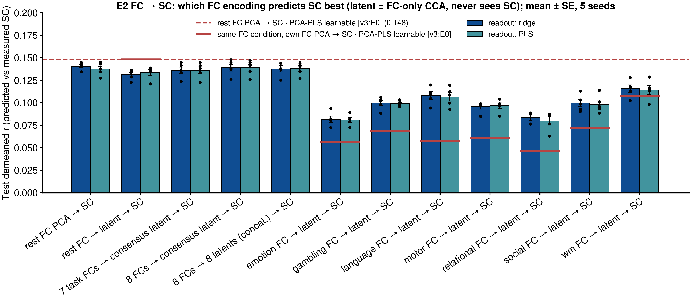
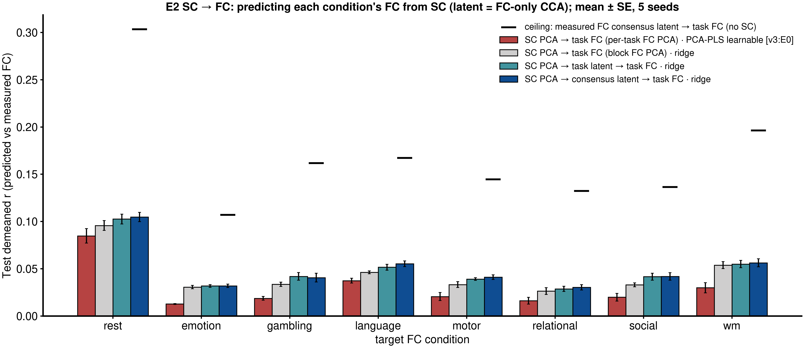

# E2: CCA-latent bidirectional benchmark

**Spec:** v4 E2 (`context_packages/repo_spec_docs/spec_doc_v4.md`), run autonomously under v4 D4.
**Code:** `config.yml`; `run_seed.py` (one seed: latent selection, FC → SC, SC → FC; `--check` = gate G1);
`launch/run_seeds.sh`, `launch/analyze.sh`; `run.py` (hypothesis tests, tables, figures). Shared library:
`models/architectures/multiview_cca.py` (MAXVAR, ridge GCV; v4 I2). Data: E1's per-seed cache
(`scripts/experiments/joint_flow_matching/common.py`).
**Outputs:** `results/Glasser/records/seed<S>*.csv`; `results/Glasser/tables/{summary.md, hypotheses.csv, fc2sc.csv,
sc2fc.csv, latent_selection.csv, latent_r2.csv}`; `results/Glasser/figures/fig_*.png`.
**Runs:** G0 (library move, E1 checks + exact L4 reproduction) local; pilot `20484872` (G1 ALL_OK), seeds 1–4
`20484873`, analysis `20484874`. CPU only, ≈ 0.6 CPU-node-hours.
**Status:** complete 2026-10-20.

---

## 1. Question

Is a multiview CCA latent of FC, the part of a subject's FC shared across the 8 conditions (rest + 7 tasks), a
better encoding for structure–function prediction than per-condition PCA codes? FC → SC with the latent as the input;
SC → FC with the latent as the target.

## 2. Setup

| | |
|---|---|
| Cohort / splits | v3:E0 matched cohort (917 Glasser subjects), seeds 0–4 (seed 0: 659 / 74 / 184), paired with v3:E0 |
| Codes | E1 equal-variance pooled FC basis and SC basis (v4 D2) |
| Latent | MAXVAR over the 8 FC conditions (never SC); encoders $A_m$, decoders $D_m$; consensus = mean of a subject's 8 encodings |
| Latent selection | **SC-blind:** $(k_{FC}, d, \lambda)$ chosen on val cross-condition identification (56 ordered pairs). Chosen in every seed: $k_{FC}$ 256, $d$ 32, $\lambda$ 0.1 (val cross-condition average rank 0.94–0.95 vs 0.66–0.69 for the same number of pooled-PCA codes). Secondary **SC-tuned** latent chosen on val FC → SC ($k_{FC}$ 512, $d$ 64–128) |
| Readouts | ridge (GCV; headline for every hypothesis) and PLS (components on val); target / input code size on val |
| Scoring | decoded edges, v3:E0 metrics, 184 test subjects; support rule: seed-mean Δ above 2 SE, same sign in ≥ 4 of 5 seeds |

## 3. Results (test, mean over 5 seeds)

### FC → SC

| Input (ridge) | Demeaned r | Avg rank | Top-1 |
|---|---|---|---|
| v3:E0 rest, PCA-PLS learnable (reference) | 0.148 | 0.878 | 0.115 |
| rest PCA codes, val-selected $k$ (in practice 512) | 0.141 | 0.879 | 0.112 |
| rest CCA encoding ($d$ 32) | 0.131 | 0.845 | 0.079 |
| 7-task consensus | 0.136 | 0.847 | 0.072 |
| 8-condition consensus | 0.139 | 0.855 | 0.082 |
| concatenated encodings (learned fusion) | 0.138 | 0.866 | 0.085 |
| 8-condition consensus, SC-tuned latent | 0.145 | 0.875 | 0.086 |

| Single condition | CCA encoding (ridge) | v3:E0 same condition | Δ (paired) | Seeds > 0 |
|---|---|---|---|---|
| rest | 0.131 | 0.148 | −0.017 ± 0.005 | 0 / 5 |
| wm | 0.116 | 0.108 | +0.008 ± 0.001 | 5 / 5 |
| language | 0.108 | 0.058 | +0.050 ± 0.014 | 5 / 5 |
| gambling | 0.100 | 0.068 | +0.031 ± 0.006 | 5 / 5 |
| social | 0.100 | 0.072 | +0.027 ± 0.008 | 5 / 5 |
| motor | 0.096 | 0.061 | +0.035 ± 0.007 | 5 / 5 |
| relational | 0.083 | 0.046 | +0.037 ± 0.012 | 5 / 5 |
| emotion | 0.082 | 0.057 | +0.025 ± 0.004 | 5 / 5 |

### SC → FC

| Target FC condition | SC PCA → task FC (per-task FC PCA) · PCA-PLS learnable [v3:E0] | SC PCA → task FC (block FC PCA) · ridge | SC PCA → task latent → task FC · ridge | SC PCA → consensus latent → task FC · ridge | Ceiling: measured FC consensus latent → task FC (no SC) |
|---|---|---|---|---|---|
| rest | 0.085 | 0.096 | 0.103 | 0.105 | 0.304 |
| wm | 0.030 | 0.054 | 0.055 | 0.056 | 0.196 |
| language | 0.037 | 0.046 | 0.052 | 0.055 | 0.167 |
| gambling | 0.019 | 0.034 | 0.042 | 0.041 | 0.162 |
| social | 0.020 | 0.033 | 0.042 | 0.042 | 0.136 |
| motor | 0.021 | 0.033 | 0.039 | 0.041 | 0.145 |
| relational | 0.016 | 0.026 | 0.029 | 0.030 | 0.132 |
| emotion | 0.013 | 0.031 | 0.032 | 0.032 | 0.107 |

Every SC input is SC's own train PCA (size 64–512 chosen on val per model and condition). E2's routes all output in
the shared block FC PCA basis (equal-variance pooled); v3:E0 uses a separate FC PCA basis per condition. The step from
the first to the second column is therefore the basis and readout (no CCA); the step from the second to the last two
columns is the latent route.

Predicted vs true consensus latent (test): mean per-dimension R² −0.06 to 0.05 across seeds, yet identification
top-1 0.05–0.15 (chance 0.005), average rank 0.86–0.90.

### Reference: full shared CCA with SC as a ninth view (E1 linear arm L4)

The same MAXVAR with SC included as a view, from `scripts/experiments/joint_flow_matching/linear_arms.py` (5 seeds;
$(d, \lambda)$ chosen on mean val demeaned r over all 72 view pairs, $d$ = 32 in most seeds; block FC PCA codes,
$k$ = 512 shown). Translation encodes the source view and decodes the target view.

| | rest | emotion | gambling | language | motor | relational | social | wm |
|---|---|---|---|---|---|---|---|---|
| SC → shared latent (with SC) → FC | 0.105 | 0.032 | 0.038 | 0.055 | 0.039 | 0.030 | 0.040 | 0.057 |
| SC PCA → consensus latent (FC-only) → FC (this benchmark) | 0.105 | 0.032 | 0.041 | 0.055 | 0.041 | 0.030 | 0.042 | 0.056 |
| FC → shared latent (with SC) → SC | 0.132 | 0.072 | 0.086 | 0.102 | 0.088 | 0.074 | 0.089 | 0.107 |
| FC → latent (FC-only) → SC (this benchmark) | 0.131 | 0.082 | 0.100 | 0.108 | 0.096 | 0.083 | 0.100 | 0.116 |

Including SC in the latent changes SC → FC by at most 0.003 and lowers FC → SC for every task (by 0.006–0.014);
8 FC conditions averaged in the latent give 0.137 for SC (vs 0.139 here). The SC-blind FC latent is at least as good
in both directions, so SC does not need to shape the latent, and the consensus latent can be used as an SC-free
target.

### Hypotheses (`tables/summary.md`)

| H | Comparison | Δ demeaned r ± SE | Seeds > 0 | Supported |
|---|---|---|---|---|
| H1 | rest CCA encoding − rest PCA codes (FC → SC) | −0.0095 ± 0.0020 | 0 / 5 | no (reversed; also avg rank −0.034, top-1 −0.033) |
| H2 | 8-condition consensus − rest encoding | +0.0075 ± 0.0017 | 5 / 5 | **yes** |
| H2 (reported) | 7-task consensus − rest encoding | +0.0045 ± 0.0018 | 4 / 5 | yes |
| H2 (reported) | concatenated − consensus | −0.0012 ± 0.0006 | 1 / 5 | no (plain mean is as good) |
| H3 | 8-condition consensus − v3:E0 rest | −0.0094 ± 0.0051 | 1 / 5 | no; not non-inferior at margin 0.01 |
| H4 | SC → consensus latent → condition − v3:E0 SC → FC (mean of 8) | +0.0202 ± 0.0025 | 5 / 5 | **yes** |
| H4 | SC → consensus latent → condition − direct SC → condition ridge | +0.0062 ± 0.0015 | 5 / 5 | **yes** |

## 4. Findings

1. **The cross-condition latent rescues task FC as an input for SC.** Every task encoded through the latent beats its
   own v3:E0 per-task model in all 5 seeds, by +0.008 (WM) to +0.050 (language) demeaned r. Short, noisy task scans
   predict SC far better once projected onto the axes they share with the other conditions.
2. **It costs rest.** A 32-dimensional SC-blind latent discards rest-specific information that carries SC signal:
   the rest encoding is 0.010 below rest's own PCA codes (all seeds) and 0.017 below the bench. H1 is reversed.
   The notebook's seed-0 H1 signal came from an unfair baseline (PCA codes with a fixed SC dimension); with the SC
   dimension chosen on val for both, PCA codes win.
3. **Fusion helps, but not past full rest.** The 8-condition consensus beats the rest encoding (5 / 5) and the
   7-task consensus alone matches it, so task FC adds subject information in the latent; but the consensus (0.139)
   stays below rest's own PCA codes (0.141) and the bench (0.148). A learned per-condition weighting adds nothing over
   the plain mean. The SC-tuned latent (larger $d$) narrows the gap to the bench (0.145).
4. **SC predicts the state-invariant functional latent better than single scans.** Routing SC → FC through the
   consensus latent beats v3:E0 on every condition (mean +0.020, all seeds; tasks roughly 1.5–2.5 × the bench) and
   beats a direct SC → condition ridge in the same codes (+0.006, all seeds). Part of the gain over v3:E0 is the
   pooled basis plus ridge (direct ridge already beats the bench); the latent route adds on top of it.
5. **The SC → latent signal is diffuse:** per-dimension R² is near zero, yet predicted latents identify subjects
   (average rank 0.86–0.90). SC carries a weak, spread-out projection of each subject's functional trait.

## 5. What this means for E1 (spec v4 E2.D)

- **SC → FC:** frame it as SC → shared latent → condition. The latent route beats direct prediction, and the gap to
  the ceiling (rest 0.105 vs 0.304) is where a nonlinear or generative model has room; the condition-specific
  remainder is the natural generative part (E3).
- **FC → SC:** a compact shared latent alone is not the right input when rest is available; it loses rest-specific
  information. Task inputs should go through the latent. A hybrid input (full rest codes + task consensus latent) is
  the obvious next test; it is cheap and closed form.
- **Follow-ups (cheap, closed form):** extend $k_{SC}$ to {8, 16, 32} (grid edge, §6); hybrid FC → SC input (rest
  PCA codes + task consensus latent).
- **The joint flow model (E1 A3 / A4)** should keep the pooled basis for FC → FC and SC pairs, and add the latent as
  an input or conditioning arm for task-sourced and SC-targeted pairs rather than replace the code space.

## 6. Caveats

- **The SC code dimension sits at the edge of its grid.** FC → SC selected $k_{SC}$ = 64, the smallest value offered,
  in 151 of 170 scored rows (v3:E2 found its optimum at 16; SC → FC input sizes spread over the whole grid). The paired comparisons share the grid, so the hypothesis results
  stand, but absolute FC → SC levels may be capped; extending the grid to {8, 16, 32} is the first follow-up.

- FC → SC rank and top-1 are partly parcel geometry (v3:C!2).
- v3:E0 rows are tuned learnable models on per-condition bases; E2 uses closed-form readouts on pooled codes, so
  "beats v3:E0" mixes the latent with the basis and readout; the paired in-codes comparisons (H1, H2, H4 vs direct)
  isolate the latent.
- Latent hyperparameters were chosen SC-blind on 74 val subjects; one configuration won in every seed.
- The SC-tuned latent rows are secondary (selected on val SC demeaned r).

Last updated at: 2026-10-20 EDT
