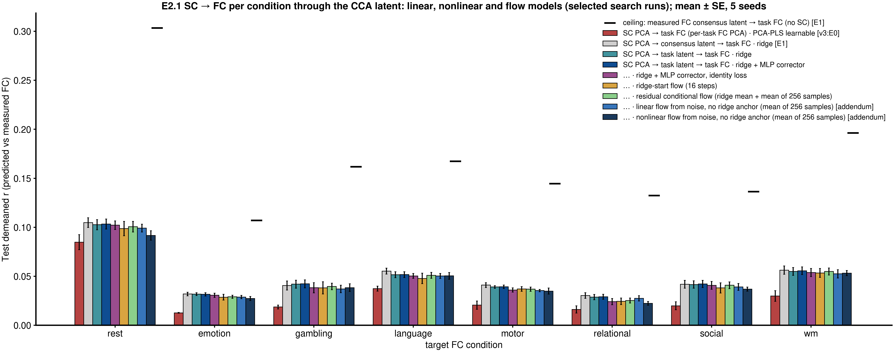
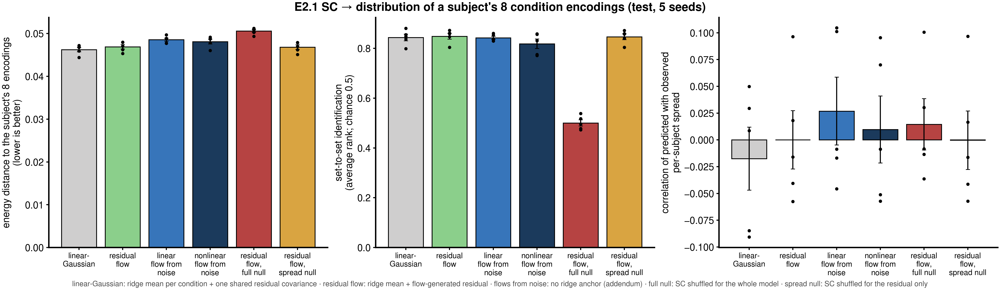
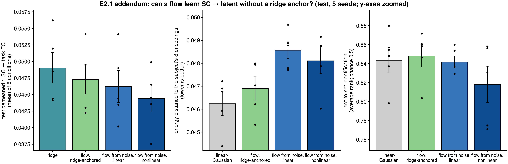

# E2: SC → functional latent (linear, nonlinear and flow models)

**Spec:** v4 E2 (`context_packages/repo_spec_docs/spec_doc_v4.md`); E2.0 pre-checks are recorded in the spec (E2.0
results). This write-up covers **E2.1**. E2.2 (cross-condition FC translation) is planned.
**Code:** `e21_common.py` (latent-target cache, linear references, gate G0b), `e21_run.py` (models, search,
evaluation), `e21_analyze.py` (hypothesis tests, tables, figures), `checks/synthetic_e21.py` (gate G1),
`checks/g3_e21.py` (gate G3), `launch/e21_*.sh`. Shared library: `models/architectures/crossmodal_flow_matching.py`
(`TokenBackbone`, with an optional conditioning input) and `models/architectures/multiview_cca.py`.
**Outputs:** `results/Glasser/records/e21/*.json`; `results/Glasser/e21/tables/{summary.md, hypotheses.csv, point.csv,
distribution.csv, latent2sc.csv, retest.csv, selected_hyperparameters.csv}`; `results/Glasser/e21/figures/*.png`.
**Runs:** gates `21016453` (G1, after two failed runs, below); pilot `21020036` / `21021826` / `21029998`; G3
`21029999`; seeds 1–4 `21030000`–`03`; analysis run locally after `21030004` failed on a table bug. ≈ 2 GPU-h.
**Status:** complete 2026-10-26.

---

## 1. Question

Given a subject's SC, can models predict their encoding in each FC condition in E1's shared functional latent, first
as a point prediction (linear and nonlinear), then as a **distribution** over the subject's 8 condition encodings?
The first pass is a baseline signal: can these models learn SC → latent at 659 training subjects, and does SC carry
information about how variable a subject's function is, beyond where it sits?

## 2. Setup

| | |
|---|---|
| Cohort / splits | v3:E0 matched cohort (917 Glasser subjects), seeds 0–4 (seed 0: 659 / 74 / 184) |
| Target | E1's SC-blind latent (block FC PCA, 256 codes per condition; 32 dimensions; λ 0.1), every subject's 8 condition encodings; decoded to each condition's FC edges for scoring |
| Input | SC's own PCA codes (64–512, chosen per model) |
| Models | **SC PCA → task latent → task FC** with: ridge (per condition); ridge + MLP corrector; corrector + identity loss; ridge-start flow; **residual conditional flow** (ridge mean + flow-generated residual, conditioned on SC and the condition token; main). Distributional reference: **linear-Gaussian** (ridge means + one shared residual covariance). Nulls: SC shuffled for the whole model; SC shuffled for the residual only |
| Search | Optuna, 32 trials per model and seed; selection on val (point models: decoded demeaned r; identity-loss model: average rank; flow: energy distance) |
| Scoring | 184 test subjects; decoded-edge metrics as v3:E0; distribution: energy distance to the subject's 8 encodings, set-to-set identification, spread calibration, rest test–retest |
| Support rule | seed-mean difference above 2 SE, same sign in ≥ 4 of 5 seeds |

## 3. Results (test, mean over 5 seeds)

### Point predictions, per condition (demeaned r)

| Model | rest | emotion | gambling | language | motor | relational | social | wm |
|---|---|---|---|---|---|---|---|---|
| SC PCA → task FC (per-task FC PCA) · PCA-PLS learnable [v3:E0] | 0.085 | 0.013 | 0.019 | 0.037 | 0.021 | 0.016 | 0.020 | 0.030 |
| SC PCA → consensus latent → task FC · ridge [E1] | 0.105 | 0.032 | 0.041 | 0.055 | 0.041 | 0.030 | 0.042 | 0.056 |
| SC PCA → task latent → task FC · ridge | 0.103 | 0.032 | 0.042 | 0.052 | 0.039 | 0.029 | 0.042 | 0.055 |
| … · ridge + MLP corrector | 0.103 | 0.032 | 0.042 | 0.052 | 0.039 | 0.029 | 0.042 | 0.056 |
| … · corrector + identity loss | 0.102 | 0.031 | 0.038 | 0.050 | 0.036 | 0.024 | 0.041 | 0.054 |
| … · ridge-start flow | 0.099 | 0.029 | 0.038 | 0.048 | 0.037 | 0.024 | 0.038 | 0.053 |
| … · residual flow (mean of 256 samples) | 0.101 | 0.029 | 0.040 | 0.051 | 0.037 | 0.025 | 0.041 | 0.055 |
| Ceiling: measured FC consensus latent → task FC (no SC) | 0.303 | 0.107 | 0.162 | 0.167 | 0.145 | 0.132 | 0.136 | 0.196 |

Averaged over the 8 conditions: ridge 0.0490, corrector 0.0494, identity loss 0.0470, ridge-start flow 0.0458,
residual flow 0.0473; full null −0.0001.

The per-condition and distribution figures also show the addendum's linear and nonlinear flows from noise (no ridge
anchor; their selected search runs, the same protocol as the residual flow; §7–8 for longer training and temperature).

### Distribution of a subject's 8 condition encodings

| | Energy distance (lower is better) | Set identification (avg rank; chance 0.5) | Set top-1 | Spread tracks the subject (r) | Predicted / observed spread |
|---|---|---|---|---|---|
| Linear-Gaussian (ridge means + one shared covariance) | **0.0462** | 0.844 | 0.065 | −0.02 | 2.47 |
| Residual flow | 0.0469 | **0.848** | **0.079** | 0.00 | 2.61 |
| Flow, SC shuffled for the residual only | 0.0468 | 0.846 | 0.076 | 0.00 | 2.61 |
| Flow, SC shuffled for the whole model (null) | 0.0506 | 0.500 | 0.007 | 0.01 | 2.58 |

Rest test–retest: the flow's predicted rest spread does not track each subject's session 1 − session 2 difference
(r −0.01 ± 0.01).

### Latent → SC (secondary)

| Input → SC | ridge | ridge + MLP corrector |
|---|---|---|
| 8-condition consensus latent | 0.139 | **0.142** |
| each task's encoding (range) | 0.082–0.116 | 0.085–0.120 |

### Hypotheses (`results/Glasser/e21/tables/summary.md`)

| H | Comparison | Δ ± SE | Seeds > 0 | Supported |
|---|---|---|---|---|
| H1 | ridge + MLP corrector − ridge (decoded demeaned r) | +0.0003 ± 0.0001 | 4 / 5 | yes, but negligible |
| H2 | corrector + identity loss − corrector (average rank) | −0.0053 ± 0.0023 | 1 / 5 | no (demeaned r −0.0024, non-inferior) |
| **H3 (primary)** | linear-Gaussian − residual flow (energy distance; > 0 = flow better) | −0.0007 ± 0.0002 | 0 / 5 | **no** (the Gaussian is slightly better) |
| H4 | flow − linear-Gaussian (set average rank) | +0.0046 ± 0.0035 | 4 / 5 | no (full null at chance, 0.500) |
| H5 | flow's spread vs each subject's observed spread | +0.000 ± 0.027 | 2 / 5 | no |
| H5 (diag.) | flow − spread-only null (spread correlation) | +0.0004 ± 0.0003 | 3 / 5 | no |
| H5 (diag.) | flow's rest spread vs session 1 − 2 difference | −0.010 ± 0.011 | 2 / 5 | no |
| H6 | residual flow mean − corrector (demeaned r) | −0.0021 ± 0.0003 | 0 / 5 | non-inferior (margin 0.005) |
| H7 | latent → SC: corrector − ridge | +0.0041 ± 0.0010 | 5 / 5 | **yes** |

## 4. Findings

1. **SC → functional latent is linear at this sample size.** The nonlinear corrector beats ridge in 4 of 5 seeds by
   +0.0003 demeaned r: reliable, but far too small to matter. The identity loss, the ridge-start flow's integration
   and the residual flow's samples all match or trail ridge.
2. **SC predicts where a subject sits, not how variable they are.** Every model with the real pairing identifies
   subjects from their generated cloud (set average rank 0.84–0.85 vs 0.50 for the full null), and that comes from
   the linear mean. No model's predicted spread tracks a subject's spread across conditions (r ≈ 0), the spread-only
   null matches the flow, and predicted rest spread does not track real session-to-session differences.
3. **A linear-Gaussian is the right generative model for SC → latent here.** The residual flow does not beat a
   Gaussian with one shared covariance on energy distance (H3, the Gaussian is slightly better in all seeds); its
   small set-identification edge (+0.005) is within noise.
4. **Most of each subject's latent is not explained by SC.** Decoded accuracy is well below the latent ceiling (rest
   0.103 vs 0.303), and both distributional models predict clouds about 2.5 × wider than a subject's observed spread:
   the uncertainty is dominated by what SC does not explain, shared across subjects.
5. **The reverse direction shows a small nonlinear gain.** Latent → SC with the corrector beats ridge in all 5 seeds
   (+0.004; consensus → SC 0.142, near the v3:E0 rest bench 0.148), the only place a nonlinear model helped.
6. **The pipeline is sound.** The gates caught two real problems (the flow's location error in the first synthetic
   run, and a shuffled null that kept the real ridge means), a target-indexing bug in latent → SC, and a too-noisy
   flow point estimate (16 → 256 samples); the full null sits at chance throughout.

## 5. What this means

- For **SC → FC**, the limit is information, not model class: linear maps capture what SC carries at 659 subjects.
  Generative modeling adds nothing that a shared-covariance Gaussian does not.
- This points E2 to **cross-condition FC translation (E2.2)**, where the conditional signal is far stronger (rest →
  task identification in E1's latent: top-1 0.46), with SC as an added view, and to **more samples per subject** (E3:
  FC timeseries windows) before asking distributional questions again.

## 6. Caveats

- The 8 encodings per subject are not independent draws; spread mixes condition-specific individuality and noise.
- The latent keeps only the cross-condition part of FC (32 dimensions); condition-specific individuality outside it
  cannot be predicted by any model here.
- Hyperparameters were searched with 32 Optuna trials per model and seed, with median pruning; models stopped early
  (1–6 min per job), so larger searches are unlikely to change point results but were not tried.
- FC → SC (H7) rank metrics are read with v4 C!1 (parcel geometry).

## 7. Addendum: can a flow learn SC → latent without a ridge anchor?

Every real-data flow above was anchored on ridge. Two un-anchored flows were added, from noise straight to each
condition's encoding, conditioned on SC and the condition token: a **linear** velocity field (linear in the state, SC
and condition, with flow-time-varying coefficients: the form of the exact flow for linear-Gaussian data, so it is the
same model class as the linear-Gaussian reference) and the **nonlinear** MLP velocity field. Code: `e21_run.py`
(`flow_linear`, `flow_free`), `checks/synthetic_e21_addendum.py`, `e21_addendum_analyze.py`; jobs `21033481`–`89`.

**Synthetic (known answer):** the nonlinear flow learns from noise alone: point R² 0.945 (ridge 0.983), energy 0.030
vs the Gaussian's 0.511, per-subject spread r 0.99. The linear flow behaves as theory says: point R² 0.914 and energy
0.505, matching the Gaussian (it cannot represent input-dependent spread; spread r −0.12). Both nulls at chance.

**Real data (test, 5 seeds):**

| SC PCA → task latent → task FC via | Demeaned r (mean of 8) | Energy (lower is better) | Set average rank | Set top-1 |
|---|---|---|---|---|
| ridge / linear-Gaussian (closed form) | **0.0490** | **0.0462** | 0.844 | 0.065 |
| flow, ridge-anchored (E2.1) | 0.0473 | 0.0469 | **0.848** | 0.079 |
| flow from noise, linear velocity | 0.0462 | 0.0486 | 0.842 | **0.084** |
| flow from noise, nonlinear velocity | 0.0444 | 0.0481 | 0.818 | 0.064 |
| nulls (SC shuffled) | −0.0003 to 0.0013 | 0.051–0.053 | 0.50–0.52 | 0.004–0.007 |

- **Yes, flow matching learns SC → latent without an anchor.** The linear flow recovers 94 % of ridge's point signal
  and the nonlinear flow 91 %, with subject identification of their clouds well above the null (0.84 / 0.82 vs 0.50).
- **It learns less efficiently than the closed form.** Both un-anchored flows trail ridge in every seed (−0.003 and
  −0.005 demeaned r) and the linear-Gaussian on energy (−0.002 in every seed): the same model class fit by stochastic
  gradients from 659 subjects loses a little to its closed-form fit.
- **Nonlinearity adds nothing on real data, though it clearly can.** On the synthetic data the nonlinear flow found
  input-dependent spread a Gaussian cannot; on real data it does not beat the linear flow. Together with E2.1's
  spread results, the real-data relation in these coordinates is linear-Gaussian at this sample size.
- Caveat (as E2.1): targets are linear CCA encodings of block FC PCA codes, chosen for linear cross-condition
  agreement; the next test uses block PCA targets.

## 8. Longer training and sampling temperature (2026-10-27)

Flows retrained at their selected settings with a 3000-epoch cap and no early stopping or best-weight pick before epoch
50 (`--retrain-selected`, tag `_long`); block-PCA flows then re-scored from the saved weights with the starting noise
scaled to T 0.25 (`--eval-only`, tag `_longT025`). Test, 5 seeds, mean of the 8 conditions.

| Route · model | Demeaned r | Average rank | Energy (lower is better) | Set average rank |
|---|---|---|---|---|
| CCA · ridge / linear-Gaussian | **0.0490** | **0.676** | **0.0462** | **0.844** |
| CCA · linear flow (1000 → 3000 cap) | 0.0462 → 0.0442 | 0.669 → 0.660 | 0.0486 → 0.0615 | 0.842 → 0.823 |
| CCA · nonlinear flow (1000 → 3000 cap) | 0.0444 → 0.0376 | 0.662 → 0.632 | 0.0481 → 0.0924 | 0.818 → 0.768 |
| block PCA · ridge / linear-Gaussian | **0.0441** | 0.662 | **0.0028** | 0.639 |
| block PCA · linear flow, T 1 → T 0.25 | 0.0380 → 0.0402 | 0.679 → **0.692** | 0.0030 → 0.0086 | 0.736 → **0.776** |
| block PCA · nonlinear flow, T 1 → T 0.25 | 0.0382 → 0.0345 | 0.664 → 0.671 | 0.0028 → 0.0094 | 0.700 → 0.729 |

- **Longer training does not help.** On the CCA route both flows get worse (the nonlinear flow overfits within a few
  epochs; its early stop at epoch 2 was the overfitting signal), on block PCA nothing changes. The flows' ceiling at
  659 subjects is reached early.
- **Lower temperature helps block-PCA point predictions and identification.** At T 0.25 the linear flow beats ridge on
  **average rank (+0.030 ± 0.003, 5 / 5 seeds) and top-1 (+0.012, 5 / 5)** while trailing on demeaned r (−0.004,
  5 / 5): the first consistent gain of a flow over the closed form, on identifiability. Its generated clouds also
  identify subjects best of all models (set average rank 0.78 vs 0.64 for the Gaussian).
- **Lower temperature costs the distributional fit** (energy 0.009 vs 0.003): narrowed clouds no longer match the
  observed spread. Temperature trades calibration for sharp, identifiable point predictions.
- Notebooks `flow_trajectories.ipynb` and `flow_learning_multitask.ipynb` (seed 0, retrained models) show the targets
  (block PCA and CCA reconstructions) next to measured FC and predictions, and the temperature sweep.

Last updated at: 2026-10-27 EDT
