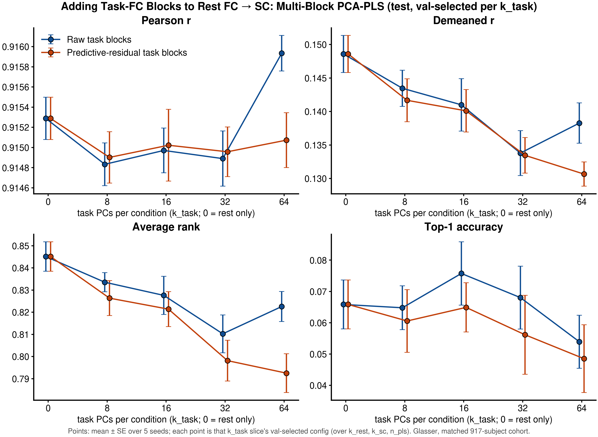

# E2: Joint task-FC → SC — do the task-FC blocks add to rest FC?

**Spec:** v3 E2 (E2.1 raw, E2.2 predictive residual), infrastructure v3 I5.
**Code:** this folder: `config.yml` (grid, versions, seeds), `grid.py` (CPU grid runner: one cohort per seed, every
`k_rest × k_task × k_sc` cell, one PLS fit truncated to every `n_pls`, metrics as the Evaluator), `launch_grid.sh`
(CPU array, seed × version), `run.py` (selection, tables, figures), `checks/` (`bench_pls_grid` feasibility,
`check_i5` acceptance, `fingerprint_fc2sc` before / after I5). Library: `FC_<task>` source modalities
(`data/hcp_dataset.py`), `CrossModal_PCA_PLS` (raw, per-block dict), `CrossModal_PCA_PLS_TaskResid` and
`fit_rest_residualizer` (`models/architectures/crossmodal_pca_pls.py`).
**Outputs:** `runs/<version>/seed<S>.csv` (every configuration, val + test metrics, block VIP shares);
`results/Glasser/{raw,predictive_resid}/` (selected configs, summary, heatmap, weave) and `results/Glasser/compare/`
(ablation curve, dimensionality, paired Δ, block contribution, selected `k_sc`).
**Status:** complete 2026-10-12 (grid 2026-10-07/08; edge extension and checks 2026-10-08).
**Runs:** grid job `19365975` (10 CPU tasks), edge extension `19454464` (`k_rest` 640, `k_sc` 8), convergence check
`19457342` (CONV_OK), I5 checks `19358187` (CHECK_OK), feasibility `19348816`. ≈ 6 CPU-node-hours, no GPU.

---

## 1. Question

For FC → SC, does adding the seven task-FC blocks to rest FC improve SC prediction over rest alone, and does that
hold for the part of each subject's task FC that their own rest FC cannot predict?

## 2. Setup

- Closed-form multi-block PCA-PLS: one train-split PCA per condition (rest + 7 tasks), scores concatenated (each
  column standardized), PLS to the SC PCs, decoded through the SC PCA.
- **raw** (E2.1): task block = PCA of the task FC. **predictive residual** (E2.2): per task, a ridge fit on the
  train split (penalty by GCV) predicts the subject's task FC from their own `k_rest` rest scores; the block is the PCA
  of the prediction error.
- Grid: `k_rest` 64–640, `k_task` 0 (rest only) – 64, `k_sc` 8–256, `n_pls` 4–128 (spec v3 E2 has the reasons; `k_rest`
  640 and `k_sc` 8 were added by the edge rule after the first pass put winners at 512 / 16). 8,010 configurations
  scored (5 seeds; raw 888 + residual 714 per seed).
  Selection per seed on val demeaned r **within each `k_task` slice**; test reported.
- FC → SC, Glasser, E0's matched 917-subject cohort and splits, seeds 0–4. CPU only.

## 3. Results

**Test demeaned r, val-selected within each `k_task` slice, mean over 5 seeds (paired Δ vs rest only ± SE):**

| k_task | Raw | Δ | Predictive residual | Δ |
|---|---|---|---|---|
| 0 (rest only) | **0.149** | — | **0.149** | — |
| 8 | 0.144 | −0.005 ± 0.002 | 0.142 | −0.007 ± 0.003 |
| 16 | 0.141 | −0.008 ± 0.001 | 0.140 | −0.009 ± 0.001 |
| 32 | 0.134 | −0.015 ± 0.003 | 0.134 | −0.015 ± 0.001 |
| 64 | 0.138 | −0.010 ± 0.002 | 0.131 | −0.018 ± 0.002 |

Average rank falls the same way (rest only 0.845 → 0.79–0.83 with tasks). Top-1 is noisy (0.05–0.08) with no
consistent gain. Pearson r is flat (0.915). Tables: `results/Glasser/{raw,predictive_resid}/tables/summary.md`,
`results/Glasser/compare/tables/`.

**Is the deficit a val-overfitting (selection) effect?** No. `compare/tables/selection_diagnostics.md`:

| k_task | Raw: val-selected test | Raw: test-oracle bound | Residual: val-selected | Residual: test-oracle | val → test gap |
|---|---|---|---|---|---|
| 0 | 0.149 | 0.151 | 0.149 | 0.151 | 0.013 |
| 8 | 0.144 | 0.146 | 0.142 | 0.146 | 0.016–0.018 |
| 16 | 0.141 | 0.142 | 0.140 | 0.142 | 0.016 |
| 32 | 0.134 | 0.139 | 0.134 | 0.136 | 0.018 |
| 64 | 0.138 | 0.142 | 0.131 | 0.132 | 0.014–0.015 |

The test-oracle column chooses each slice's config on test, so it is a diagnostic upper bound, never a result. Even
there, no with-task slice (best 0.146) reaches the *val-selected* rest-only model (0.149), so no selection procedure
(k-fold, consensus, nested CV) can make the task blocks win in this model class. Consensus selection (one config by
mean val across seeds) gives the same order. The val → test gap is slightly larger with tasks (0.016–0.018 vs
0.013): selection optimism grows with input size, but it is secondary. On val itself the task slices are already
behind rest only.

**Findings**
1. **Task-FC blocks add no FC → SC signal over rest FC in multi-block PCA-PLS,** raw or predictive residual, at any
   `k_task`. Each costs 0.005–0.018 demeaned r, paired in all 5 seeds.
2. **The individualized, task-specific residual does not help either.** It is no better than raw at small `k_task` and
   worse at `k_task` 64 (−0.018 vs −0.010).
3. **Rest dimension beats task dimension.** In the `k_rest × k_task` heatmap (`raw/figures/heatmap_rest_task.png`)
   `k_task = 0` is the best column in every `k_rest` row, on val and test. At `k_rest` 64, adding 64 task PCs per
   condition partly makes up the lost dimension (test 0.129 vs 0.127), never as much as more rest PCs (0.149 at 512).
4. **PLS gives task blocks about twice their size share but the weight does not generalize.** At the best with-task
   slice (`k_task` 8), each task block carries ≈ 0.02 of the explained SC variance (block VIP) vs ≈ 0.011 expected from
   its column count; rest carries 0.84–0.87 vs ≈ 0.92 (`compare/figures/block_contribution.png`). WM and gambling are
   the largest task blocks in the raw version. Together with finding 1, PLS fits train-specific structure in the
   task blocks.
5. **The target dimension does not move up with tasks.** Selected `k_sc` is 16 in almost every seed and slice (8 in a
   few `k_task` 32–64 residual cells; `compare/figures/selected_k_sc.png`). The extra input doesn't make higher SC PCs
   predictable.
6. **Rest-only optimum:** `k_rest` 512–640 (≈ the 658-PC maximum), `k_sc` 16, `n_pls` 16; test demeaned r 0.149,
   matching E0.1's learnable rest model (0.148) on the same cohort.

## 4. Checks

- I5 acceptance (`checks/check_i5.sh`, job `19358187`): the grid runner equals `main.py` for a raw, a residual and a
  rest-only cell (max diff ≤ 1e-7); residual blocks are ~uncorrelated with rest scores (max |r| 0.17); infinite
  ridge penalty reproduces raw; a plain FC source is unchanged by I5 (identical sha256).
- PLS truncation is exact (max rel. diff 7e-16, `checks/bench_pls_grid.py`).
- Convergence: 5,060 of 8,010 rows logged NIPALS "maximum iterations"; refitting every slice winner with
  `max_iter` 5000, `tol` 1e-8 changes demeaned r by ≤ 0.0002 (`checks/check_convergence.sh`, job `19457342`, CONV_OK).

## 5. Caveats

- Closed-form PLS with per-column standardization gives every PC column equal prior weight, so the model cannot
  down-weight a noisy block as a whole. That is the main untested model-class limit (follow-up 1).
- A whole-connectome metric can hide a regional gain (the WM / MTL hypothesis); no regional analysis was run.
- `k_rest` winners sit at 640, close to the 658-PC maximum (cannot be extended further).
- Task blocks differ in scan length, so a task's added value is partly data quantity.

## 6. Follow-ups (not scheduled)

1. **Block-weighted regression:** group ridge with one penalty per block (or per rest / task), or PLS with block
   scaling instead of per-column standardization, so the fit can switch task blocks off. This is the remaining way
   task FC could help a linear model.
2. **Regional Δ maps:** per-region demeaned r of the predicted SC rows, (rest + task) − rest, seed-paired, FDR across
   regions, for the WM / MTL hypothesis.
3. **More stable selection** (k-fold CV on train + val, or consensus): low priority. The test-oracle bound shows
   selection cannot change the conclusion here.
4. Learnable multi-block model and composite losses: deprioritized given no linear gain.

Last updated at: 2026-10-12 EDT
