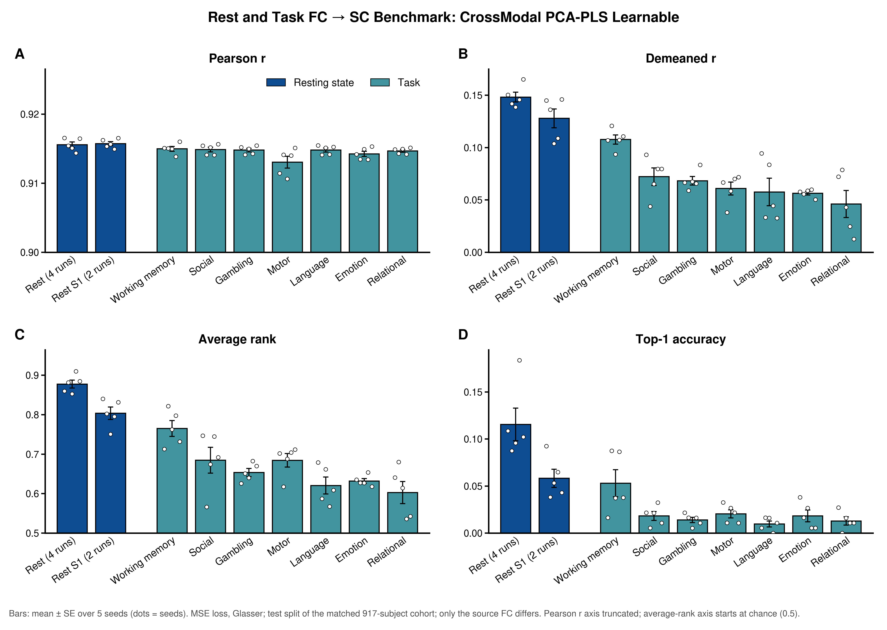
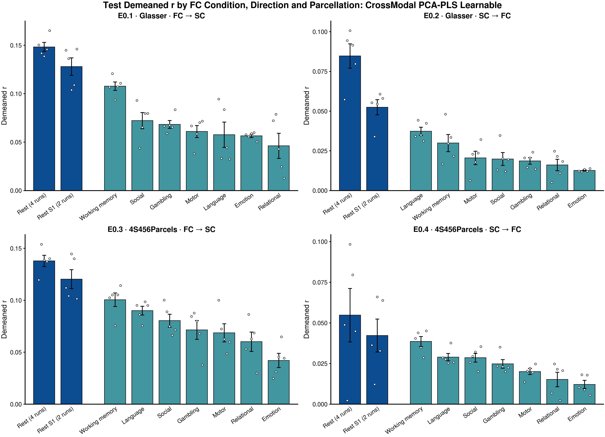

# E0: Which task FC best predicts SC, and which is best predicted from SC

**Steps (spec v3 E0, run under D1):** E0.1 FC → SC Glasser (done) · E0.2 SC → FC Glasser · E0.3 FC → SC 4S456Parcels ·
E0.4 SC → FC 4S456Parcels. Sections 1–6 are E0.1; section 7 adds E0.2–E0.4 and the cross-step comparison.
**Code:** this folder: `config.yml` (steps, conditions, seeds, tune budget, D1 gate / budget, labels), `make_configs.py` →
`configs/<parcellation>/<condition>.yml` (direction-free), `launch.sh` (one task; passes `--parcellation`, sets
`--source/--target` from the direction, cleans its Ray outputs), `submit.py` (one array per step × condition, index =
seed), `autopilot.py` (status / gate / budget / launch, host python), `run.py` (`--step E0.x`: scrape, tables, figures;
`--compare`), `checks/check_fc_source_condition.{py,sh}` (cohort, splits, rebinding, PCA mean, SC → FC target).
**Outputs (tracked):** `results/<parcellation>/<direction>/tables/{seed_records,summary,runs,paired_vs_rest}.csv`,
`summary.md`; `.../figures/bars_{pearson,demeaned_pearson,avg_rank,top1_acc,all_metrics}.png`, `scan_time.png`;
`results/compare/` across steps.
**Folder:** `task_bidirectional_bench` (was `task_fc2sc` until 2026-10-07; logs before then record the old config
paths, which `autopilot.verify` accepts).
**Runs:** logs `results/logs/<job_prefix>_<condition>_<job>_<seed>.out` (`config.yml` steps; E0.1 = `e0_taskfc_<condition>`).
E0.1: pilot jobs `19251071` (rest), `19251073` (wm), full run `19253190`–`19253201`; check job `19248618` (ALL_OK).
**Status:** complete 2026-10-07 (E0.1 2026-10-06; E0.2–E0.4 2026-10-07 under spec v3 D1)

---

## 1. Question

For FC → SC, which FC condition (rest or one of the seven HCP tasks) gives the best SC reconstruction, on Pearson r,
demeaned r, average rank and top-1?

## 2. Setup

| | |
|---|---|
| Model / loss | `CrossModal_PCA_PLS_learnable`, MSE only, v2:E2.2 FC → SC config; 16-trial Optuna/ASHA tune per seed |
| Source | FC of one condition: `rest` (4 runs, reference), `rest_S1` (session 1, 2 runs), 7 tasks (LR+RL combined) |
| Target | SC (default metric, log1p), Glasser |
| Cohort / splits | subjects with every condition: 917 of 957; per-seed `train_val_test` labels restricted to it (seed 0: 659 / 74 / 184); seeds 0–4, identical across conditions |
| Comparison | test split; Δ = paired-by-seed difference from `rest`, ± SE over 5 seeds |
| Compute | 45 tasks on 1 GPU each (4 trials packed), median 17 min (13–30): 13.6 GPU-h; ≈ 10.5 h wall clock (group GPU quota allowed 1–2 tasks at once) |

Every run loads all conditions, so the cohort and splits are the same; `fc_source_condition` rebinds the FC arrays
before the train-split PCA, so the source PCA basis is fit on that condition.

## 3. Results (test, mean over 5 seeds; Δ vs rest ± SE)

| Source FC | Scan time | Pearson r | Demeaned r | Δ | Avg rank | Δ | Top-1 | Δ |
|---|---|---|---|---|---|---|---|---|
| Rest (4 runs) | 57.6 min | 0.9156 | 0.1483 | — | 0.878 | — | 0.116 | — |
| Rest S1 (2 runs) | 28.8 min | 0.9157 | 0.1280 | −0.020 ± 0.007 | 0.804 | −0.074 ± 0.017 | 0.058 | −0.057 ± 0.017 |
| Working memory | 9.7 min | 0.9150 | 0.1078 | −0.041 ± 0.006 | 0.765 | −0.113 ± 0.018 | 0.053 | −0.063 ± 0.017 |
| Social | 6.6 min | 0.9149 | 0.0723 | −0.076 ± 0.007 | 0.685 | −0.193 ± 0.033 | 0.018 | −0.097 ± 0.014 |
| Gambling | 6.1 min | 0.9148 | 0.0684 | −0.080 ± 0.002 | 0.654 | −0.224 ± 0.004 | 0.014 | −0.102 ± 0.017 |
| Motor | 6.8 min | 0.9131 | 0.0610 | −0.087 ± 0.005 | 0.685 | −0.193 ± 0.020 | 0.021 | −0.095 ± 0.017 |
| Language | 7.6 min | 0.9148 | 0.0577 | −0.091 ± 0.015 | 0.621 | −0.257 ± 0.031 | 0.010 | −0.106 ± 0.020 |
| Emotion | 4.2 min | 0.9143 | 0.0565 | −0.092 ± 0.006 | 0.632 | −0.246 ± 0.009 | 0.018 | −0.097 ± 0.021 |
| Relational | 5.6 min | 0.9147 | 0.0462 | −0.102 ± 0.016 | 0.603 | −0.275 ± 0.035 | 0.013 | −0.103 ± 0.018 |

Scan time = HCP volumes (LR+RL, or 4 / 2 rest runs of 1200) × TR 0.72 s. Top-1 chance with 184 test subjects is 0.005.

## 4. Findings

1. **Rest is the best source on every individual-level metric, and every task is below it.** Each task loses
   0.04–0.10 demeaned r, 0.11–0.28 avg rank and 0.06–0.11 top-1 against rest; all paired Δ are several SE from zero.
   Pearson r is flat (0.913–0.916) because it is dominated by the group-mean SC every condition predicts.
2. **Working memory is the clear best task.** It beats every other task in demeaned r on 5/5 seeds (WM − social
   +0.036 ± 0.011; WM − gambling +0.040 ± 0.006) and keeps half of rest's top-1 (0.053), while the other six tasks
   sit near 0.01–0.02.
3. **Scan length explains much, but not all, of the ordering.** Halving rest (rest S1) costs 0.020 demeaned r and half
   of top-1; WM, with a third of rest S1's scan time, is a further 0.020 lower (5/5 seeds) in demeaned r but matches
   it in top-1 within noise. Among the six shorter tasks the spread is small (0.046–0.072) and only loosely tracks
   length (language, the second-longest task, is fifth). Condition and data quantity remain confounded
   ([`scan_time.png`](results/Glasser/fc2sc/figures/scan_time.png); Pearson r on log scan time / Spearman ρ, all 9 conditions vs
   tasks only: demeaned r 0.94 / 0.83 vs 0.73 / 0.64, avg rank 0.92 / 0.78 vs 0.70 / 0.54, top-1 0.93 / 0.65 vs
   0.61 / 0.25; the all-9 values lean on the two rest points). WM sits above the log-scan-time fit in every metric.
   A length-matched comparison
   (truncate rest to a task's volume count) would separate them.
4. **Rest on the matched cohort is close to E2.2.** 0.148 demeaned r / 0.878 avg rank vs v2:E2.2's 0.162 / 0.889 on
   the full 957-subject cohort with 64-trial tunes; the gap is consistent with the smaller cohort and tune budget.
5. **Seed spread is larger for some tasks** (language, relational, social: SE over seeds 0.008–0.013 demeaned r vs
   0.002–0.006 for emotion, gambling, motor, WM), so the order among the six shorter tasks is not settled with 5 seeds.

## 5. Caveats

- Scan length differs by condition (§3) and is not controlled; see finding 3.
- 16-trial tunes (v2:E2.2 used 64); per-condition hyperparameters differ (`tables/runs.csv`).
- E0.1's best-trial reports predate the `parcellation` / `fc_source_condition` / `n_subjects` summary fields; `run.py`
  asserts each E0.1 result ran its condition's config (FC → SC). Later steps check all three.

## 6. To-do (easily executable)

- 4S456Parcels replication and SC → task FC: now E0.2–E0.4.
- Length-matched rest control (optional, not scheduled) (rest truncated to WM's / a short task's volume count).

## 7. E0.2–E0.4: both directions, both parcellations

**Runs (D1, autonomous):**
- Pilots (rest + wm, seed 0): E0.2 `19312075`, `19312078`; E0.3 `19312080`, `19312081`. Both gates passed. E0.2
  rest seed-0 test demeaned r was 0.057, against the v2:E2.2 reference 0.071 ± 0.02.
- Full runs: E0.2 `19313047`–`19313060`; E0.3 `19314222`–`19314230`; E0.4 `19314231`–`19314239`.
- Pre-flight check `19311017`: ALL_OK.
- 135 tasks completed with no retries.
- 54.3 GPU-h: E0.2 14.8, E0.3 20.8, E0.4 18.7. That is under the 55 GPU-h cap. Queue waits later reached about 14 h,
  which triggers the D1 cut to 44 GPU-h for new launches. Every task had been submitted before the waits passed 2 h,
  so the cut never blocked a launch, but total use ended above the cut value.
- Per-task Ray cleanup removed each task's Ray temp and Tune storage (about 7–8 GB per Glasser task).

**Test demeaned r (mean over 5 seeds)** — full tables in `results/<parcellation>/<direction>/tables/summary.md`;
cross-step tables in `results/compare/tables/`; figure `results/compare/figures/demeaned_r_by_step.png`:

| Condition | E0.1 Glasser FC → SC | E0.2 Glasser SC → FC | E0.3 4S456 FC → SC | E0.4 4S456 SC → FC |
|---|---|---|---|---|
| Rest (4 runs) | **0.148** | **0.085** | **0.138** | **0.055** |
| Rest S1 (2 runs) | 0.128 | 0.053 | 0.120 | 0.042 |
| Working memory | 0.108 | 0.030 | 0.101 | 0.039 |
| Language | 0.058 | 0.037 | 0.090 | 0.029 |
| Social | 0.072 | 0.020 | 0.080 | 0.029 |
| Gambling | 0.068 | 0.019 | 0.072 | 0.025 |
| Motor | 0.061 | 0.021 | 0.069 | 0.020 |
| Relational | 0.046 | 0.016 | 0.060 | 0.015 |
| Emotion | 0.057 | 0.013 | 0.042 | 0.012 |

**Findings**
1. **Rest is best in all four cells, and rest S1 second.** Every task is below rest on demeaned r, paired by seed.
2. **Working memory is the best task in three of four cells.** In E0.2 (Glasser SC → FC), language is ahead
   (0.037 vs 0.030; the SEs overlap).
3. **The condition order on demeaned r replicates.**
   - Spearman ρ over the 9 condition means is 0.77–1.00 across every pair of cells (tasks only: 0.50–1.00).
   - E0.3 and E0.4 (4S456, both directions) give the same order.
   - Average rank and top-1 agree less (ρ 0.17–0.90 over all conditions; some task-only ρ are near 0 or negative),
     because most tasks sit close to chance on these metrics.
4. **SC → FC is harder and compresses the task range.**
   - Rest drops from 0.148 to 0.085 (Glasser) and from 0.138 to 0.055 (4S456).
   - Tasks fall to 0.012–0.039, close to the SC → FC null (v2:E2.2 null 0.011).
   - Raw Pearson r also falls for tasks (0.39–0.65 vs about 0.82–0.84 for rest). In FC → SC it stays flat at about 0.91.
   - In SC → FC the condition is the *target*, so a noisier task FC limits the attainable score. This direction mixes
     "SC predicts this condition less well" with "this FC is less reliable". There is no task test-retest ceiling,
     and the split-half ceiling was not run (user decision, D1).
5. **Scan time tracks the order in every cell** (demeaned r vs log scan time, Pearson / Spearman):

   | Cell | All 9 conditions | Tasks only |
   |---|---|---|
   | Glasser FC → SC | 0.94 / 0.83 | 0.73 / 0.64 |
   | Glasser SC → FC | 0.97 / 0.98 | 0.80 / 0.96 |
   | 4S456 FC → SC | 0.94 / 0.95 | 0.97 / 0.89 |
   | 4S456 SC → FC | 0.93 / 0.95 | 0.92 / 0.89 |

   Within tasks, scan length explains more of the order on 4S456 than on Glasser.
6. **Parcellation changes levels little in FC → SC** (rest 0.148 vs 0.138). In SC → FC it costs about 0.03 for rest,
   and E0.4 rest is the noisiest cell (see caveat).

**Caveats (E0.2–E0.4)**
- E0.4 rest seed 1 scored test demeaned r 0.002, against val 0.074. Its selected config freezes every block, with
  random init. That seed's mean val–test gap across conditions is normal (0.009), so this is 16-trial selection
  noise, not a failed run. It widens the E0.4 rest SE (± 0.016).
- The time limit for each step came from 1.5 × the longest finished run on that parcellation (the first E0.2 launch
  was cancelled and resubmitted before any task started). The longest E0.3 task ran 0.80 h against its 0.82 h limit.

Last updated at: 2026-10-07 EDT
